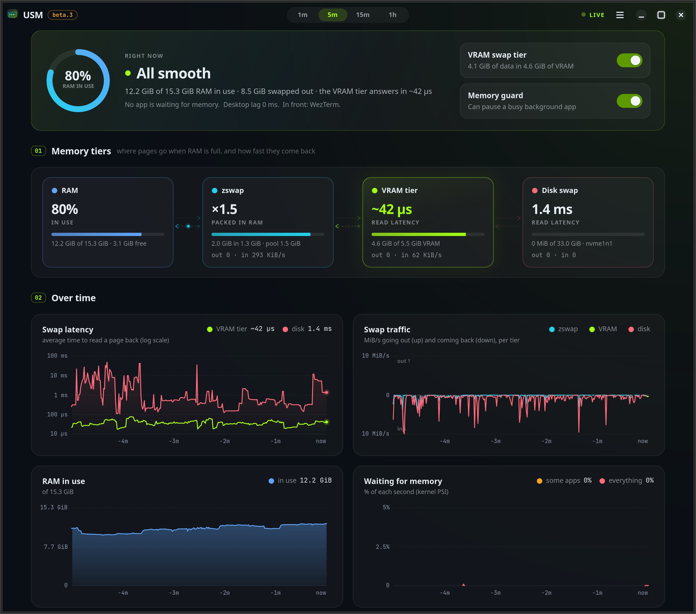

# USM: your graphics card's spare memory as RAM overflow

[](https://github.com/kha333n/usm/actions/workflows/ci.yml)
[](https://github.com/kha333n/usm/releases)
[](#beta-read-this-first)
[](LICENSE)
[](#what-you-need)

**Run more apps than your RAM holds, without the slowdown.** USM gives Linux a fast swap tier made of the idle memory
on your NVIDIA graphics card, and a guard that keeps the desktop responsive when memory runs out. You don't need new
hardware or kernel patches, and your apps run unchanged.

> [!WARNING]
> **Beta software.** USM is in beta testing, was written mostly by AI, and has been tested on few machines. It works
> very well there, but **don't install it on critical systems.** [Read this first.](#beta-read-this-first)

*Every project needs a reason to exist. Ours has a name.*

## 🐏 Dedicated to Ram Altman

In October 2026, on the *Cheeky Pint* podcast, OpenAI's CEO said:

> *"From a global allocation perspective, actually, it's quite terrible to have everybody have a bunch of the
> world's limited supply of DRAM sitting in their own computer."*

He added that our PCs only use it about 5% of the time. The internet answered with memes of gamers guarding their RAM
sticks like dragon gold. A week later he renamed himself **"Ram Altman"** on X and posted *"i want you to have so much
ram. lets build more."* ([1](https://www.androidheadlines.com/2026/11/sam-altman-rebrands-ram-altman-ram-quote.html),
[2](https://officechai.com/ai/sam-altman-ram-altman/))

Thank you, Ram. While you build more, we looked inside our own computers. Next to the RAM we were told we use 5% of
the time sat a few gigabytes of very fast memory that really *was* doing nothing: the memory on the graphics card.

So we borrowed it. It needs no data center and costs nothing, and our DRAM stays in our computers, where it belongs. 🐏

*(To be fair: he says the quote was taken out of context and that he wants everyone to have tons of memory. We'd love
that too. Until the prices agree, here's plan B.)*

## The story

In late 2025, AI data centers started buying memory faster than factories could make it. OpenAI's Stargate deals
with Samsung and SK Hynix alone were reported at up to 900,000 DRAM wafers a month, which analysts put at roughly 40%
of the world's output ([background](https://en.wikipedia.org/wiki/2024%E2%80%93present_global_memory_supply_shortage)).
Through 2026, RAM for ordinary PCs doubled or tripled in price. Upgrading an 8 or 16 GB laptop used to be a cheap fix
and became a painful purchase. On many laptops the RAM is soldered anyway.

Running out of RAM rarely crashes anything. The real problem starts earlier: once RAM is around 90% full, Linux
starts swapping, moving memory that hasn't been used lately out to the disk. From then on, every app that touches a
swapped-out page has to wait for the disk, and the whole system slows down. However fast your SSD is, it's far
slower than memory. A page comes back from a good NVMe SSD in ~55 µs or more, and in whole seconds when the drive is
busy with other work. The more you open, the slower everything gets.

Yet many of those PCs, laptops especially, carry an NVIDIA GPU with 4–12 GB of its own memory. Unless you game,
render, edit video or run AI, that memory sits almost empty. On most laptops the screen isn't even driven by that GPU.
For most people, most of the time, the most expensive memory in the machine does nothing.

USM puts it to work:
- **More room, much faster swap.** When RAM fills up, Linux swaps the coldest pages into the GPU's memory instead
  of the SSD. A page comes back in ~9 µs, about 7× faster than NVMe swap, and GPU memory never stalls the way a busy
  SSD does. lz4 compression fits ~3× more, so a 6 GB card holds ~16 GB.
- **It steps aside.** When another program needs the GPU's memory, USM gives it back by itself, piece by piece, and
  takes it again once that program is done. `usm off` frees all of it in seconds; there's a switch on the desktop too.
- **A guard.** It watches for real memory stalls and briefly pauses a busy background app, so the app you're using
  and the desktop stay responsive. Nothing gets killed.

It isn't more RAM. But if you can't buy more, it's the next best thing: a lot more room, and swapping much closer
to RAM speed than any SSD can give you.

## Why "USM"?

USM stands for **Unified Storage Memory**. The project began as an idea for one memory space spread across
everything in a PC that can hold data (RAM, the graphics card's memory, the SSD), where apps just see "memory" and
never need to know where a page actually lives.

This first version builds that from parts Linux already has. The fastest place comes first: RAM, then compressed
RAM (zswap), then the GPU's memory, and the disk only for what still doesn't fit. Your apps don't change at all.

## Beta: read this first

- **Beta, in testing:** version 0.1. One laptop uses it daily and two were tested
  ([benchmarks](docs/benchmarks.md)). It hasn't been tested on many distributions, GPUs or workloads.
- **Written with AI:** the code, tests and docs were written by Claude (Anthropic's AI coding agent) under the
  author's direction. Review it like code from a new contributor.
- **What can go wrong:** the swapped data lives in GPU memory, served by a user-space program. If that program
  crashes, or the GPU driver resets, **the data in VRAM is lost and the apps it belongs to crash.** The program is
  hardened against this, but beta is beta.
- **Don't use it on critical systems:** production servers, or machines with work you can't afford to lose.
- No warranty ([MIT](LICENSE)). Removing it is easy: `sudo usm uninstall`.

## What you need

| | |
|---|---|
| **Linux** | systemd, cgroup v2, kernel with `ublk_drv`, Python 3.10+. Tested: Ubuntu 26.04 (kernel 7.0). Should work: Ubuntu 24.04+, Debian 13, Fedora, Arch (not tested yet) |
| **GPU** | NVIDIA with the NVIDIA driver (proprietary or open). No CUDA toolkit needed. AMD and Intel: not yet. Without one, you still get the guard and the logger |
| **Desktop** | GNOME 45–50 for the guard and the Quick Settings menu. Other desktops and servers: tier and logger only |
| **Disk** | Free space for the standby swap file: as big as the VRAM used, at most 4 GiB (`STANDBY_MB`), more only while it's needed |

**Help it grow:** you can help with development, and with testing on more systems and GPUs: other distributions,
other NVIDIA cards, and AMD and Intel GPUs, which need a new backend. Test results, bug reports and pull requests
are all welcome, and we'll keep widening support over time too. See [Docs](#docs) for how to report.

## Install

```bash
# prebuilt release (https://github.com/kha333n/usm/releases):
curl -LO https://github.com/kha333n/usm/releases/download/v0.1.0-beta.3/usm-0.1.0-beta.3-linux-x86_64.tar.gz
tar xzf usm-0.1.0-beta.3-linux-x86_64.tar.gz && cd usm-0.1.0-beta.3-linux-x86_64
sudo ./install.sh

# or from source:
git clone https://github.com/kha333n/usm.git && cd usm && make
sudo ./install.sh
```

The installer checks the machine, asks a few questions (GPU memory to use, compression, what to switch on) and can
also run unattended (`--yes --tier on --guard on`). Downloads, building, all options, upgrades and uninstalling:
**[docs/install.md](docs/install.md)**.

## Use



```bash
usm app                     # the app (above): live charts, every swap's latency, the tier and guard switches
usm status                  # everything at a glance
usm dash                    # the live view in a terminal
usm on  /  usm off          # the VRAM tier (it gives VRAM back to other GPU programs by itself)
usm guard on / off          # the guard
usm config show             # settings; change with: sudo usm config set KEY=VALUE
usm report                  # what happened in the last 24 h
usm check                   # what works on this machine
sudo usm uninstall
```

The GNOME Quick Settings menu has a "VRAM swap" toggle with memory, VRAM and swap usage, the guard and its paused
apps; its "Live view" opens the app. The app is optional: the installer adds it where GTK 4.14+ and libadwaita are
there for Python (Ubuntu 24.04 and newer have them).

## How well it works

On the test laptop (8 GiB of RAM, 8 apps × 1.5 GiB, guard on), the desktop's worst response with the VRAM tier was
**0.5–61 ms**, against 75–320 ms with zram. **0 of 4 runs hung, against 3 of 6.** Nothing was killed and all data
was correct. Details, the author's machine with and without USM, and a script to benchmark your own:
**[docs/benchmarks.md](docs/benchmarks.md)**.

## Docs

- [Install](docs/install.md): prebuilt, from source, options, upgrade, uninstall
- [Settings](docs/configuration.md): every setting
- [Benchmarks](docs/benchmarks.md): with and without USM
- [How it works](docs/how-it-works.md): the daemon, compression, spill, sleep, the guard's rules
- [Test results](docs/test-results.md): data checks, sleep, guard
- [FAQ](docs/faq.md): games, battery, hibernation, other GPUs and desktops, known limits, roadmap

Bug reports and results from other machines are very welcome: see [Contributing](CONTRIBUTING.md), open a
[test report](https://github.com/kha333n/usm/issues/new?template=test_report.yml) or
[bug report](https://github.com/kha333n/usm/issues/new?template=bug_report.yml), or ask in
[Discussions](https://github.com/kha333n/usm/discussions). Security problems: [SECURITY.md](SECURITY.md).

## License

[MIT](LICENSE). Third-party code included: [THIRD_PARTY_NOTICES.md](THIRD_PARTY_NOTICES.md). NVIDIA, CUDA and
GeForce are trademarks of NVIDIA Corporation. USM isn't affiliated with NVIDIA, OpenAI or anyone named above.
